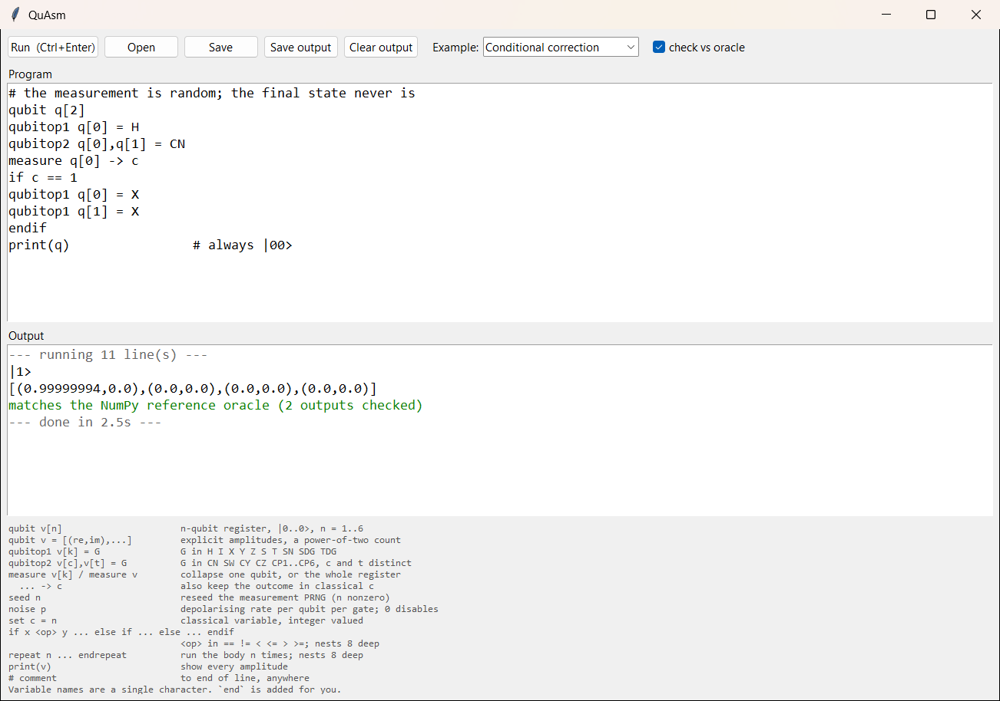

# QuAsm

[](https://github.com/shriii1389/quasm/actions/workflows/tests.yml)
[](LICENSE)
[](docs/ARCHITECTURE.md)

A quantum-simulator DSL whose interpreter is written entirely in hand-coded RISC-V
assembly. It started as a Computer Organization & Design class project. Declare a register
of up to 6 qubits, apply gates to any of them, measure, branch on the outcome, loop — the
statevector maths, the parser, the symbol tables and the PRNG are all assembly, with no
library underneath.

Deliberately minimal and pedagogical, not a production simulator: float32 amplitudes,
single-character variable names, no dynamic memory. Every limit is a fixed-size `.data`
region you can see in the source, which is rather the point.

```
qubit q[2]
qubitop1 q[0] = H              # superposition
qubitop2 q[0],q[1] = CN        # entangle: a Bell pair
print(q)                       # [(0.70710677,0.0),(0.0,0.0),(0.0,0.0),(0.70710677,0.0)]
measure q[0] -> c              # |1>
if c == 1                      # undo the flip, whichever way it landed
qubitop1 q[0] = X
qubitop1 q[1] = X
endif
print(q)                       # always |00>
end
```



More in [docs/screenshots](docs/screenshots/README.md): the command line, the quantum
Fourier transform, error messages, and the verification suite running.

## Running a program

The interpreter runs under [RARS](https://github.com/TheThirdOne/rars), a single-jar
RISC-V simulator. `tools/fetch_rars.sh` downloads it and verifies its SHA-256 before
leaving it in place.

### Versions

Any JDK 11+ and Python 3.9+ should work, but every number reported in the paper and in
this README was produced under exactly these, and these are what CI pins:

| Component | Pinned version |
|---|---|
| Java | Temurin JDK 21.0.12.1 |
| Python | 3.12.10 |
| RARS | v1.6 (`sha256:780f730e...8c24`) |
| Python packages | `requirements.txt` (numpy 1.26.4; qiskit 1.3.1 for cross-validation) |

```sh
pip install -r requirements.txt
bash tools/fetch_rars.sh
```

On Windows, run the script from Git Bash, or download `rars1_6.jar` from the
[RARS v1.6 release](https://github.com/TheThirdOne/rars/releases/tag/v1.6) into `tools/`
yourself. Only NumPy is needed to run and test programs; Qiskit is for
`tools/cross_validate.py` alone.

The RARS digest is trust-on-first-use: it pins every machine to the same bytes this
project was tested against and catches later accidental change, but GitHub publishes no
digest for that 2019 release asset, so it is not a supply-chain guarantee. The script
says so in a comment, and so does the paper.

```sh
python tools/quasm.py examples/bell.dsl          # run a script
python tools/quasm.py examples/coin_flips.dsl -o flips.txt
python tools/quasm.py examples/ghz.dsl --check   # ...and check it against NumPy
python tools/quasm_gui.py                        # editor + Run button
```

Or drive the interpreter directly, one statement per line on stdin:

```sh
java -jar tools/rars1_6.jar nc sm main.s < examples/bell.dsl
```

`examples/` has runnable programs; `docs/LANGUAGE.md` is the full reference.

## The language

```
qubit v[n]                      n-qubit register initialised to |0...0>, n = 1..6
qubit v = [(re,im),(re,im),...] explicit amplitudes; the count must be a power of two
qubitop1 v[k] = G               single-qubit gate: H I X Y Z S T SN SDG TDG
qubitop2 v[c],v[t] = G          two-qubit gate: CN SW CY CZ CP1..CP6; c and t distinct
measure v[k] [-> c]             collapse one qubit, print |0> or |1>
measure v [-> c]                collapse the register, print |q0q1...>
seed n                          reseed the measurement PRNG (n nonzero)
noise p                         depolarising rate per qubit per gate; 0 disables
set c = n                       classical variable, integer valued
if x <op> y ... else if ... else ... endif
                                <op> in == != < <= > >=; nests 8 deep
repeat n ... endrepeat          run the body n times; nests 8 deep
print(v)                        print every amplitude
end                             stop; inside a block, stops execution early
# comment                       to end of line, anywhere
```

Lines may be indented and a tab counts as a space. Integers are 32-bit; decimals may use
exponents (`6e-1`) and must be 0 or of magnitude from `1e-18` to below `1e18`. Anything
outside those limits is an error — never a silently wrapped or truncated value — and every
error names its line: `Line 12: Qubit index out of range`. A bad line is reported and
skipped, and the rest of the program still runs (`examples/errors.dsl`).

A register of n qubits is 2^n amplitudes in basis order `|q0 q1 ... qn-1>`, so qubit 0 is
the most significant bit of an amplitude index. (Qiskit uses the opposite convention —
see [docs/LANGUAGE.md](docs/LANGUAGE.md) before comparing output against it.)

The gate set `{H, T, CN}` is universal, and the controlled-phase family `CP1..CP6` makes
the quantum Fourier transform directly expressible:

```
qubit q[3]
qubitop1 q[0] = H
qubitop2 q[1],q[0] = CP2
qubitop2 q[2],q[0] = CP3
qubitop1 q[1] = H
qubitop2 q[2],q[1] = CP2
qubitop1 q[2] = H
qubitop2 q[0],q[2] = SW
print(q)     # QFT|000> = the uniform superposition, to 7 decimal places
```

`noise p` turns on a depolarising channel — after each gate, every qubit it touched has
probability `p` of being hit by a random Pauli. One run is one quantum trajectory, so
noisy programs are run many times and counted rather than printed once.

The optional `-> c` on a measurement keeps the outcome as an integer — 0 or 1 for a single
qubit, the basis index for a whole register — which is what lets `if` react to it. Together
with `repeat`, that is enough for conditional correction, repeat-until-success loops, and
the classical half of a teleportation-style protocol.

Measurement is reproducible by default: the PRNG starts from a fixed seed, so the same
program gives the same outcomes every run until you say `seed n`.

## Tests

```sh
python tools/run_tests.py -j 4          # all 230 programs, four at a time
python tools/run_tests.py cond_ loop_   # narrow to matching filenames
```

`tools/run_tests.py` runs every program in `tests/programs/` through both the assembly
(under RARS) and `tools/reference_sim.py`, an independent NumPy oracle written from the
language's semantics rather than from the assembly, and diffs the two. An expected error
must be an error to *both*, and a program not expected to fail must print no error at all.

Programs run through `tools/rars_server.py`, which keeps one RARS process per worker and
assembles the interpreter once, rather than paying for a cold JVM and a fresh assembly on
every program; it checks that nothing leaks between runs and that its output is
byte-for-byte the command line's. `QUASM_RARS=cli` goes back to one JVM per program. The oracle is
deliberately built differently — it contracts tensors where the assembly walks bit indices,
and walks a parsed block tree where the assembly replays recorded lines — so agreement is
evidence rather than a transcription check.

Measurement is checked by replaying the outcomes the assembly reported: every one must have
been possible under exact math, the collapsed state must match, and frequencies over many
trials must match the Born rule. A static audit (`tools/check_gate_data.py`) parses the
gate matrices straight out of `main.s` and checks each is unitary and is the gate it claims
to be — because a behavioural test only distinguishes two matrices where its input state
has nonzero amplitude, which is how a wrong controlled-Z once survived four dedicated
tests.

### The other layers

The behavioural suite and the static audit are two of six checks. The rest are separate
tools, because each answers a question the others cannot.

```sh
python tools/cross_validate.py --self-test                 # is the Qiskit mapping right?
python tools/cross_validate.py --seed 1 --n 5000 --max-qubits 5   # oracle vs Qiskit
python tools/cross_validate.py --seed 0 --n 200 --rars     # all three engines

python tools/properties.py --self-test            # does each property fail when violated?
python tools/properties.py --n 200                # properties against the oracle
python tools/properties.py --engine rars --n 40   # ...against the real assembly

python tools/fuzz.py --n 300 -j 4                 # differential fuzzing, a few minutes

python tools/mutate.py --full --all-code          # every constant and code mutant; hours
python tools/mutate.py --full --code-mutants 0 --zero-init-rewrite   # the controlled arm
```

**`cross_validate.py` — an independently authored second opinion.** Everything else here
was written by one person, so a shared misconception would go unnoticed. This compares
against [Qiskit](https://www.qiskit.org/) over seeded corpora of random circuits, every
register declared with explicit random amplitudes. The qubit mapping between the two
conventions (QuAsm puts qubit 0 in the most significant bit, Qiskit in the least) is fixed
a priori and never adjusted to make a failure go away; `--self-test` proves it by inverting
the mapping and confirming the asymmetric circuits fail. Corpora regenerate byte for byte
from their seed.

**`properties.py` — invariants instead of fixed expectations.** Eight: norm preservation
(including on registers that are deliberately not normalised), inverse identities on
random asymmetric states, permutation equivariance, collapse invariants, Born-rule
agreement between the two measurement forms, circuit identities between different gates,
the Clifford+T Toffoli checked against the permutation it must perform, and QFT^4 = I.
`--self-test` breaks each invariant on purpose and confirms the property notices —
including reinstating the original `P(0) = 1 - P(1)` bug.

**`fuzz.py` — inputs nobody chose.** Generates programs from the grammar — well-formed
ones, and the same with one line corrupted — and reports any disagreement between the
assembly and the oracle. On the code as it stood before the 2026-09-27 fixes it re-found
13 of the 17 interpreter defect classes those fixes address; on the fixed code, 2,900
programs give no disagreement.

**`mutate.py` — measuring whether any of it works.** Seeds defects into the gate constants
and the kernel, then counts what each layer catches. The full corpus kills all 628
meaningful constant mutants. Keeping every program but starting every register in
`|0...0>` (`--zero-init-rewrite`) drops that to 476 — the inputs are the only change —
while the static audit stays at 628, which is the whole argument for auditing constants.

## Repository layout

| Path | What is there |
|---|---|
| `main.s`, `*.s` | the interpreter. `main.s` `.include`s the rest; [ARCHITECTURE.md](docs/ARCHITECTURE.md#the-files) goes file by file |
| `examples/` | runnable programs, one idea each |
| `tests/programs/` | the 230-program corpus, harness directives in `# key: value` comments |
| `tools/` | the runners (`quasm.py`, `quasm_gui.py`), the NumPy oracle, and every verification tool |
| `docs/` | the language reference, the architecture, the defect log, screenshots |
| `paper/` | the write-up, its LaTeX source, and the claims ledger |
| `.github/workflows/` | CI: the fast checks and the full suite on every push, the deep checks weekly |

## Documentation

- [docs/LANGUAGE.md](docs/LANGUAGE.md) — the full language reference, one example per
  statement, every error message, and the limits in one table.
- [docs/ARCHITECTURE.md](docs/ARCHITECTURE.md) — memory layout, the bit-indexed gate
  kernel, the complex encoding, the PRNG, the noise channel, instruction cost, and how
  lines, loops and branches actually work.
- [CONTRIBUTING.md](CONTRIBUTING.md) — setup, conventions, and how to add a statement.
- [docs/DEFECTS.md](docs/DEFECTS.md) — every defect the verification found, by class.
- [docs/screenshots](docs/screenshots/README.md) — the GUI, the command line and the
  verification tools, running.
- [CHANGELOG.md](CHANGELOG.md) — what is in each release.
- [paper/quasm.pdf](paper/quasm.pdf) ([source](paper/quasm.tex)) — the write-up: the
  verification layers, the defects they found and why the tests of the time missed them,
  and the mutation measurements. [paper/CLAIMS.md](paper/CLAIMS.md) ties each claim to its
  evidence.

## Verification

The first three layers, which fail independently (the other three are above):

1. **A deliberately divergent oracle.** `tools/reference_sim.py` implements the same
   semantics in NumPy using different *algorithms* — tensor contraction where the assembly
   walks bit indices, a parsed block tree where the assembly replays recorded lines. Two
   implementations agreeing by different routes is evidence; a transcription agreeing with
   itself is not.
2. **A static audit of constant data.** `tools/check_gate_data.py` parses the `.float`
   declarations straight out of `main.s` and checks all 20 matrices are unitary and are the
   gates they claim to be. This exists because a behavioural test only distinguishes two
   matrices where its input has nonzero amplitude — which is how a controlled-Z encoding
   `Z⊗I` survived four dedicated CZ tests.
3. **Replay for stochastic behaviour.** Measurement outcomes can't be diffed across two
   PRNGs, so the harness replays the outcomes RARS reported and checks each was possible,
   that the collapse matches, and that frequencies follow the Born rule.

Three real defects came out of this, and the [paper](paper/quasm.tex) argues they share a
structure: in each case the tests never placed weight where a plausible wrong
implementation would differ. A second round — hostile inputs and the fuzzer — found
seventeen more in the interpreter and thirteen in the oracle, harness and mutation tool,
every one in a part of the input space the hand-written tests never reached. They are
listed in [docs/DEFECTS.md](docs/DEFECTS.md).

## Known limits

6 qubits per register and 8 maximum-size registers in the 4096-byte arena; 31 classical
variables; loops and conditionals nest 8 deep; a loop body is capped at 2048 bytes and a
line at 1022; names are one character; amplitudes are float32.

I/O goes through RARS's `ecall` interface (`li a7,4/8/11/2`), which is simulator-specific
rather than a hardware or Linux ABI, so QuAsm needs RARS to run. Porting it to bare metal
would mean rewriting all I/O and is out of scope.

**This is not quantum control hardware, and the distinction matters.** QuAsm keeps the
statevector in the processor's own memory, which is exactly the thing a real quantum
control processor cannot do — a controller emits pulses and receives measurement bits, it
never holds amplitudes. There is also no notion of time here: no cycle budget, no schedule,
no feedback-latency model, where deterministic nanosecond timing is the defining constraint
of actual control hardware. The noise model samples one Pauli trajectory per run rather
than tracking a density matrix, so it reproduces the depolarising channel in expectation
but models neither T1/T2 relaxation nor readout error.

What is fair to say is narrower: mid-circuit measurement, a classical variable holding the
outcome, and branching on it is the real-time control structure OpenQASM 3 and eQASM added
because static circuit descriptions could not drive hardware — and it fits in a few hundred
instructions on a minimal classical host. That is a statement about how small the classical
control surface is, not a claim to have built a controller. (Unrelated project, similar
name: [RISC-Q](https://arxiv.org/abs/2505.14902) by Liu et al. is a generator for real
quantum control SoCs.)

## Contributors

- [Shriharshith Keshav](https://github.com/shriii1389)
- [Infinittle](https://github.com/Infinittle)

## License

MIT, see [LICENSE](LICENSE).
