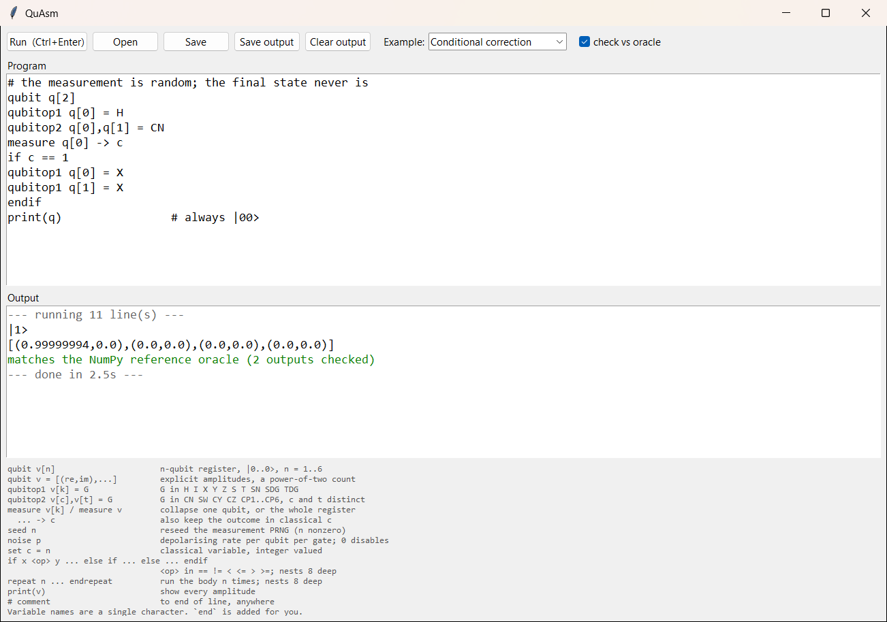
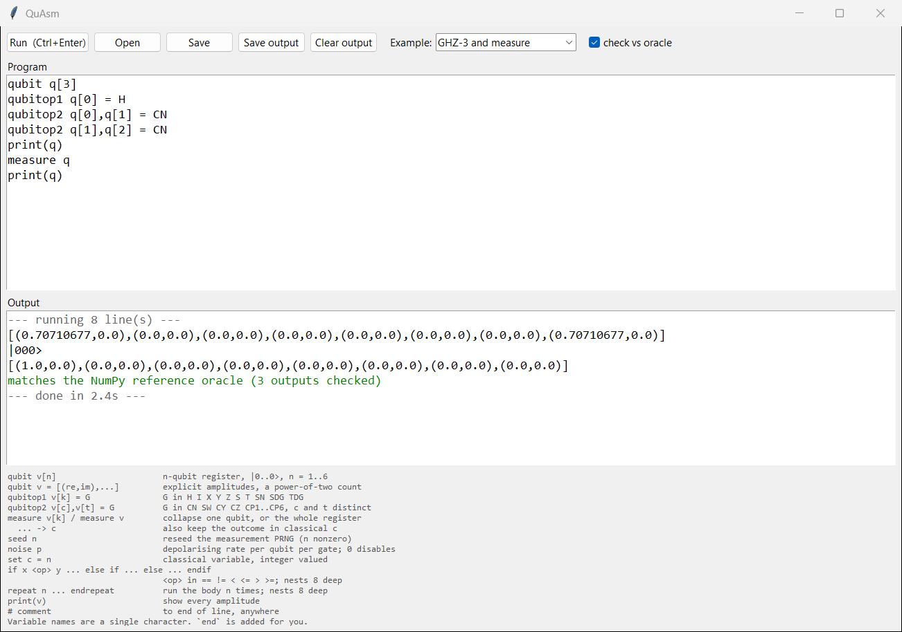
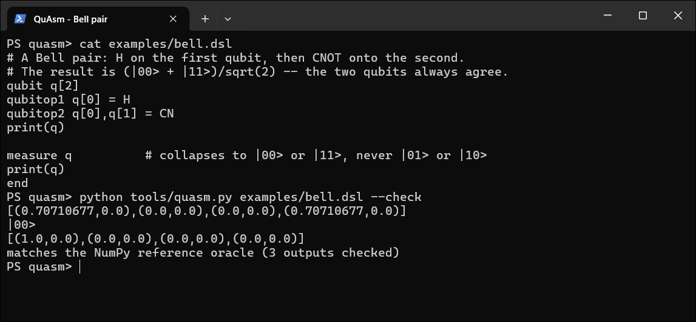
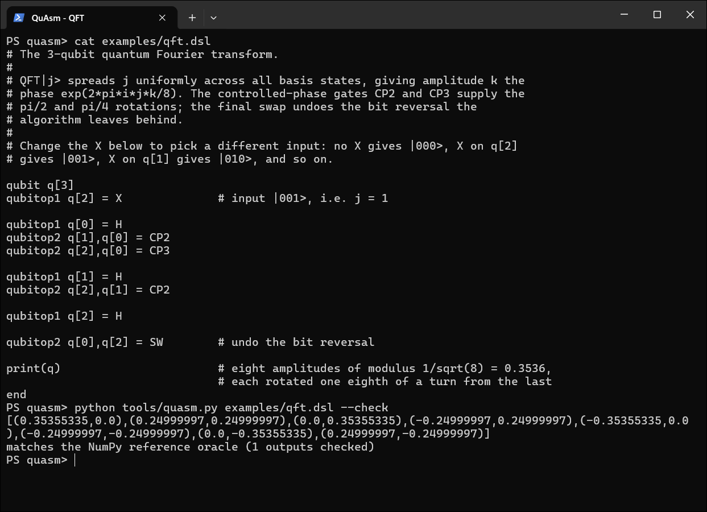
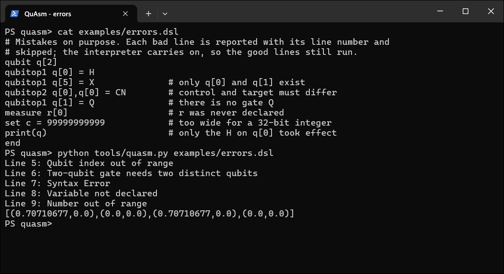
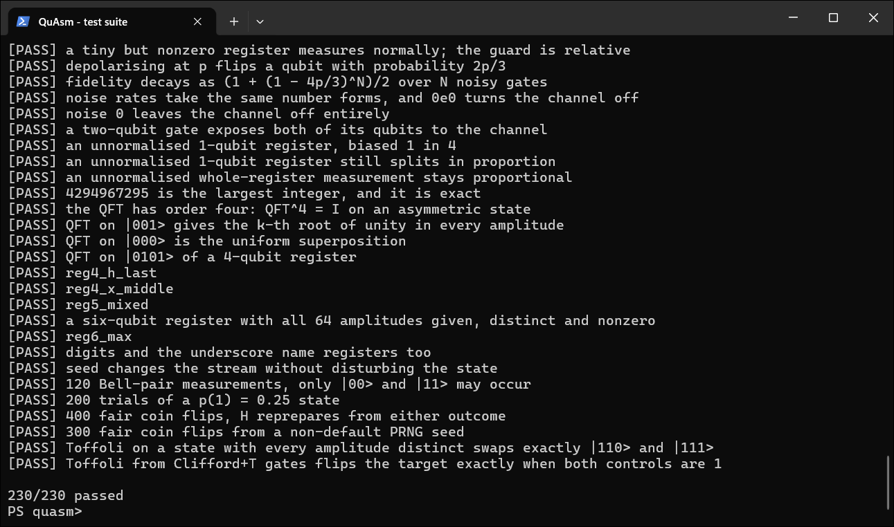
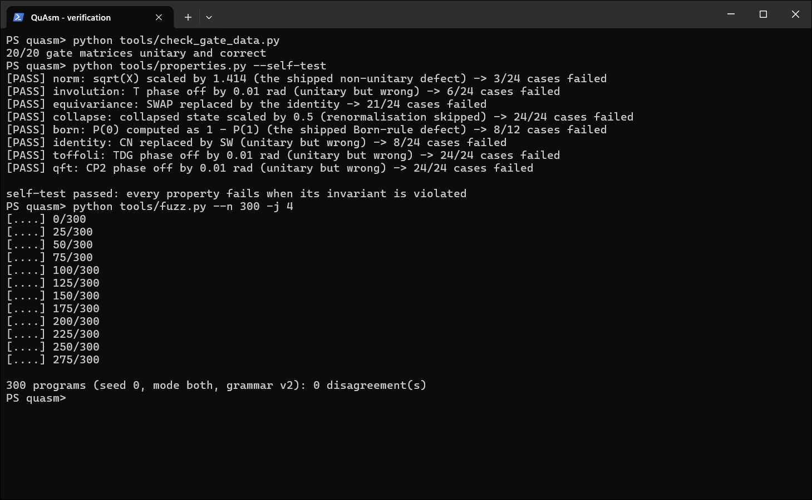

# Screenshots

QuAsm running on Windows 11. Every image is a capture of a real window: the GUI
(`tools/quasm_gui.py`) or Windows Terminal running the command shown. Nothing is mocked up.
Each terminal shot starts at the command, so you can run the same thing yourself and get
the same output; measurement is seeded, so even the random outcomes repeat.

## The GUI

`python tools/quasm_gui.py`: an editor, a Run button, a dropdown of examples, and a
"check vs oracle" box that replays the run through the NumPy reference simulator.

**Branching on a measurement.** Half of a Bell pair is measured into `c`, and `if c == 1`
flips both qubits back. The outcome is random (here `|1>`); the final state is always
`|00>`. The `0.99999994` is float32 rounding, not an error.



**A GHZ state, then a whole-register measurement.** Three qubits in
`(|000> + |111>)/sqrt(2)` collapse together: one measurement decides all three.



## The command line

**A Bell pair**, with `--check` replaying the run through the oracle.

```
python tools/quasm.py examples/bell.dsl --check
```



**The 3-qubit quantum Fourier transform** of `|001>`: eight amplitudes of modulus
`1/sqrt(8)`, each an eighth of a turn round from the last.

```
python tools/quasm.py examples/qft.dsl --check
```



**Errors name their line.** A bad line is reported and skipped; the rest of the program
still runs, so the final `print` shows the one `H` that was valid.

```
python tools/quasm.py examples/errors.dsl
```



## Verification

**The test suite**: 230 programs, each run through the RISC-V assembly under RARS and
through the NumPy oracle, and diffed. (The tail of the run; about 25 seconds with four
workers.)

```
python tools/run_tests.py -j 4
```



**Three of the other layers.** The static audit of the gate matrices; the property
suite's self-test, which deliberately breaks each invariant, including the two defects
that once shipped, and confirms the property notices; and 300 fuzzer-generated programs
with no disagreement between the assembly and the oracle.

```
python tools/check_gate_data.py
python tools/properties.py --self-test
python tools/fuzz.py --n 300 -j 4
```


